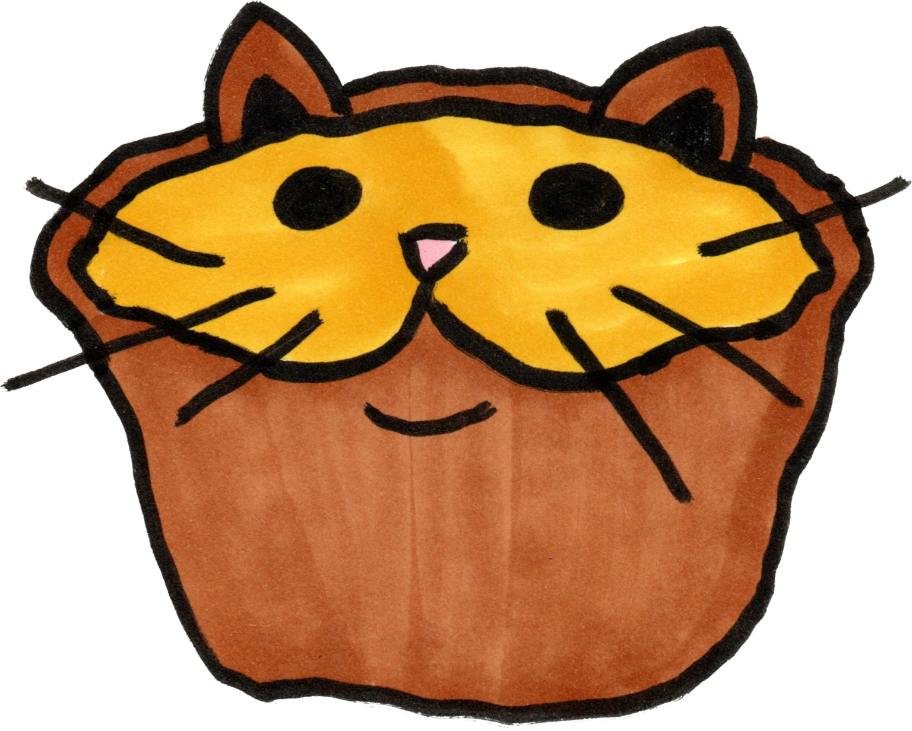
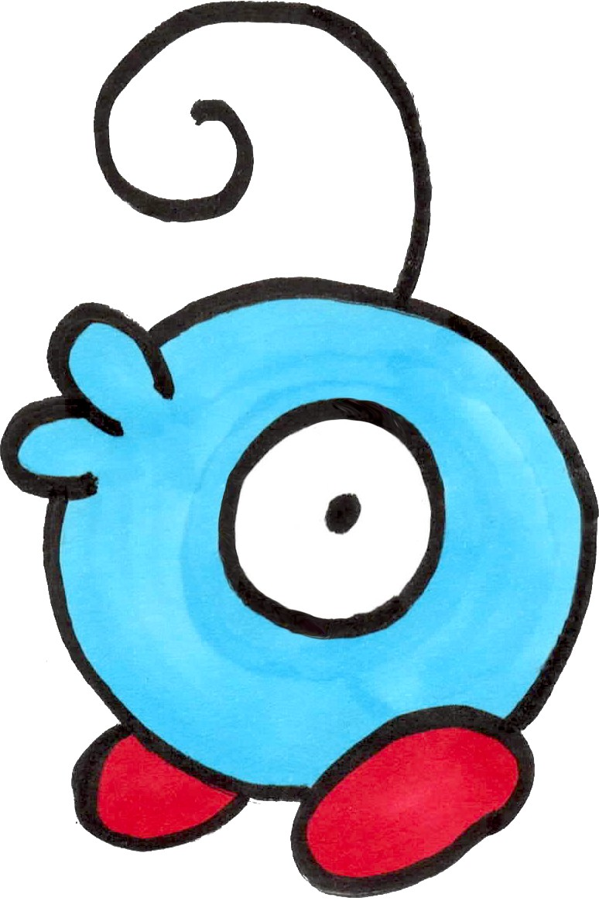
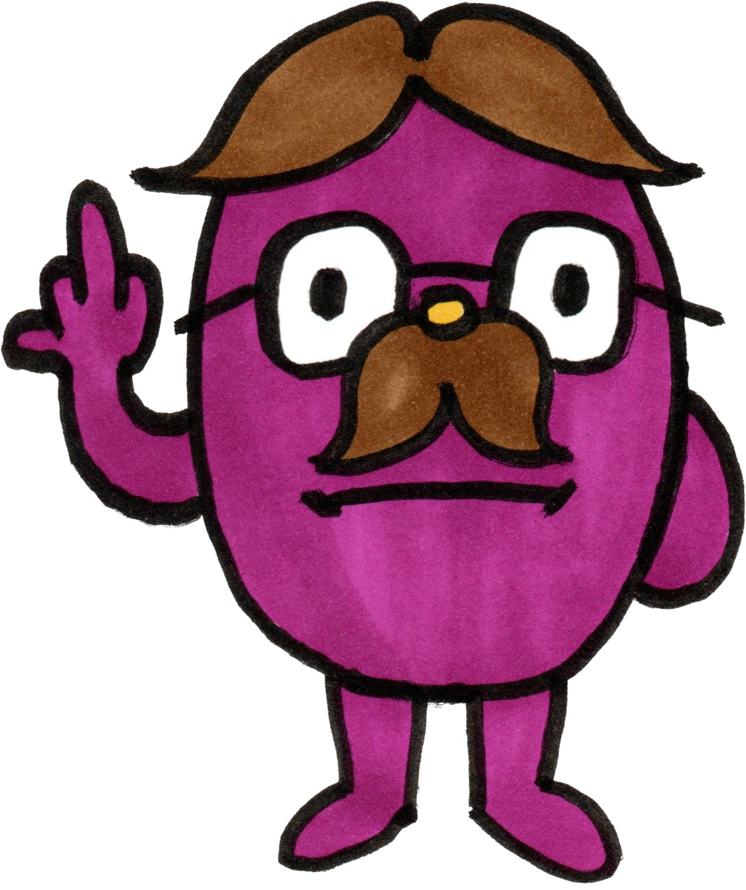
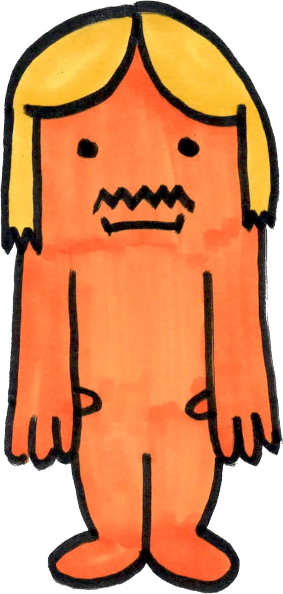
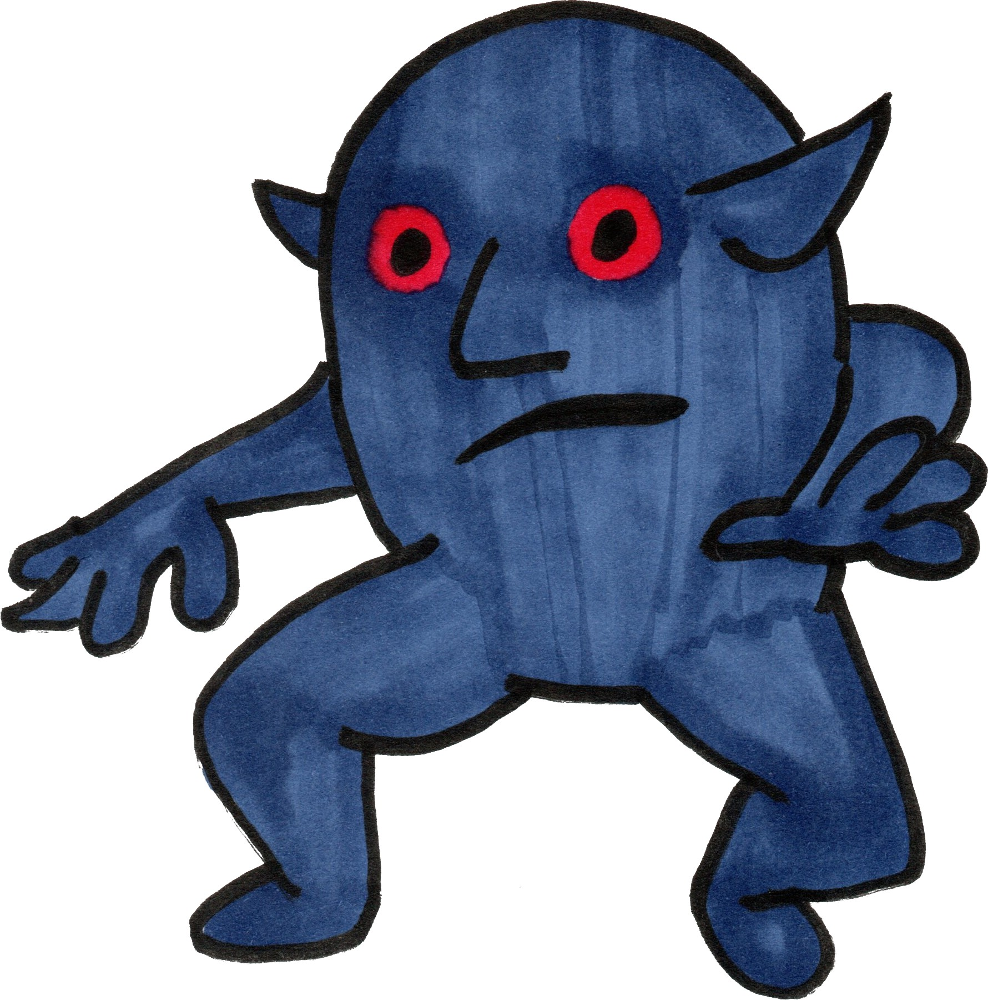
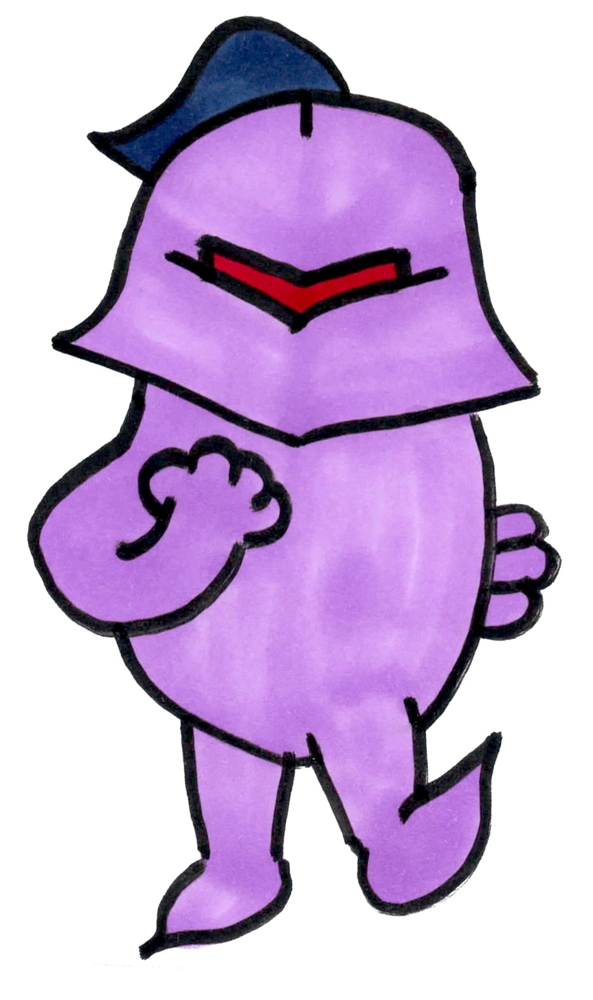

## LA COLLECTION «TWADO»!

Wow! Such livres!

Titres parus (incluant dans le futur et dans l'hypothétique):

<table>
    <thead>
    </thead>
    <body>
        <tr>
            <td rowspan="2">
                
            </td>
            <th>
                <a href="./mme-je-veux-pas-dormir/text.pdf">
                    Madame JE-VEUX-PAS-DORMIR
                </a>
            </th>
        </tr>
        <tr>
            <td>
                Madame Je-Veux-Pas-Dormir a un problème: Elle passe son temps à être fatigué!
                Si seulement il y avait une solution pour qu'elle puisse arrêter de dormir...
            </td>
        </tr>
        <tr>
            <td rowspan="2">
                
            </td>
            <th>
                <a href="./mme-gobelin/text.pdf">
                    Madame GOBELIN
                </a>
            </th>
        </tr>
        <tr>
            <td>
                Madame Gobelin est à venir!
            </td>
        </tr>
        <tr>
            <td rowSpan="2">
                
            </td>
            <th>
                <a href="./mme-nata/text.pdf">
                    Madame NATA
                </a>
            </th>
        </tr>
        <tr>
            <td>
                Madame Nata est à venir!
            </td>
        </tr>
        <tr>
            <td rowSpan="2">
                
            </td>
            <th>
                <a href="./mme-fin-de-phrase/text.pdf">
                    Madame FIN-DE-PHRASE
                </a>
            </th>
        </tr>
        <tr>
            <td>
                Madame Fin-De-Phrase est à venir!
            </td>
        </tr>
        <tr>
            <td rowSpan="2">
                
            </td>
            <th>
                <a href="./cossin/text.pdf">
                    Monsieur LETTE
                </a>
            </th>
        </tr>
        <tr>
            <td>
                Monsieur Lette est prêt pour un bon petit pique-nique avec sa blonde,
                mais après une longue attente, elle n'arrive toujours pas...
                 
                Qu'est-ce qui peut bien la retenir?
            </td>
        </tr>
        <tr>
            <td rowSpan="2">
                
            </td>
            <th>
                <a href="./d-gaboue/text.pdf">
                    Monsieur GABOUÉ
                </a>
            </th>
        </tr>
        <tr>
            <td>
                Monsieur Gaboué est à venir!
            </td>
        </tr>
        <tr>
            <td rowSpan="2">
                
            </td>
            <th>
                <a href="./m-je-suis-pas-fatigue/text.pdf">
                    Monsieur JE-SUIS-PAS-FATIGUÉ
                </a>
            </th>
        </tr>
        <tr>
            <td>
                Monsieur Je-Suis-Pas-Fatigué est resplendissant d'énergie, et a tout plein de plans
                pour sa journée. C'est étrange pourtant, il y a des moments qu'il ne se rapppelle
                pas.
            </td>
        </tr>
        <tr>
            <td rowSpan="2">
                
            </td>
            <th>
                <a href="./m-baba/text.pdf">
                    Monsieur BABA
                </a>
            </th>
        </tr>
        <tr>
            <td>
                Par une belle journée de fin d'été, monsieur Baba en profite en allant avec ses amis
                au parc. Il faut en profiter, il est en congelé! Interdicte de ne pas s'amuser.
            </td>
        </tr>
        <tr>
            <td rowSpan="2">
                
            </td>
            <th>
                <a href="./m-ca-fait-la-job/text.pdf">
                    Monsieur ÇA-FAIT-LA-JOB - à venir
                </a>
            </th>
        </tr>
        <tr>
            <td>
                Monsieur Ça-Fait-La-Job est à venir!
            </td>
        </tr>
        <tr>
            <td rowSpan="2">
                
            </td>
            <th>
                <a href="./m-arreter-quand-je-veux/text.pdf">
                    Monsieur ARRÊTER-QUAND-JE-VEUX
                </a>
            </th>
        </tr>
        <tr>
            <td>
                Monsieur Arrêter-Quand-Je-Veux est à venir!
            </td>
        </tr>
        <tr>
            <td rowSpan="2">
                
            </td>
            <th>
                <a href="./m-twado/text.pdf">
                    Monsieur TWADO
                </a>
            </th>
        </tr>
        <tr>
            <td>
                Monsieur Twado est à venir!
            </td>
        </tr>
        <tr>
            <td rowSpan="2">
                
            </td>
            <th>
                <a href="./barnak/text.pdf">
                    Monsieur MÉDIOCRE
                </a>
            </th>
        </tr>
        <tr>
            <td>
                Monsieur Médiocre sera le dieu de quelque chose, coûte que coûte. Il a un plan, et
                c'est impossible qu'il échoue. Un château et une reine, c'est tout ce qu'il a besoin.
            </td>
        </tr>
    </body>
</table>

## Idées:
* M. Arrêter-Quand-Je-Veux fait une journée de travail bien normale, mais il trimballe sa console
    partout et il n'est pas du tout présent.
* M. Twado - Lettres garbled, et images gravées apocalyptiques.
    On commence le conte avec l'histoire de l'arrivée de twado, c'est normal. C'est twado qui parle garbled

    > on faisait les tests de gestion d'escape de backslash dans le cours de compil
    > pis comme test case on s'est ramassé avec "\"twado" ou de quoi dans le genre
* M. Gaboué -

Retrouve tous tes héros sur https://twado.neocities.org \
Édité par diroum JEUNESSE, 2920, chemin de la tour, Montréal. \
Pas de dépôt légal. \
Définitivement hors la loi sur les publications destinées à la jeunesse.
